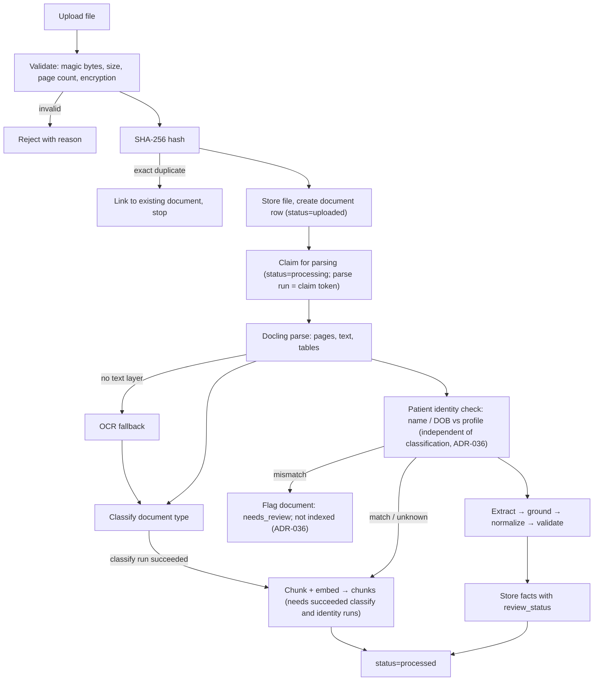
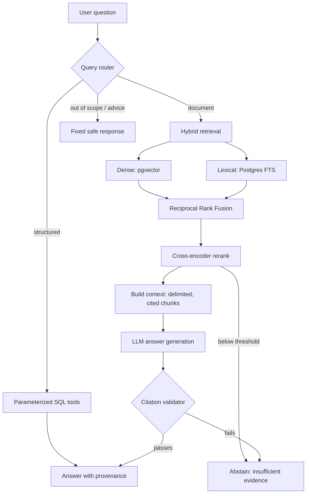
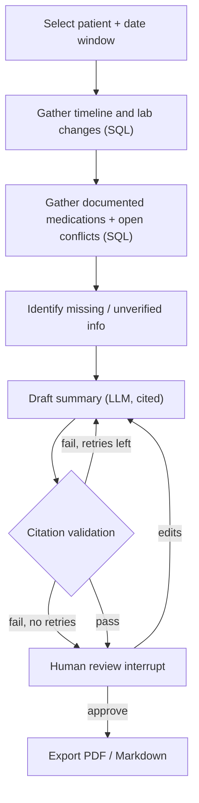

# Architecture

> **Status: Design (Phase 0).** This is the target architecture. Modules and directories are created only when their phase begins (see [ROADMAP.md](ROADMAP.md)). Decisions referenced as ADR-xxx are in [DECISIONS.md](DECISIONS.md).

## 1. Overview

MediMind is a **layered modular monolith**. It is one Python application with strict internal boundaries:

```
Streamlit UI  →  services (use cases)  →  domain modules  →  repositories  →  PostgreSQL + pgvector
                                              ↓
                                       LLM provider interface
```

Guiding principles:
1. **SQL/Python for facts and arithmetic, RAG for unstructured text.** An LLM never computes a trend or compares numbers (ADR-003).
2. **Every fact has provenance.** It records the document, page and excerpt. Original and normalized values are stored separately.
3. **Flag, never resolve.** Conflicts, ambiguities and implausible values are surfaced to the user, not fixed silently.
4. **Abstain over guessing.** If the evidence is insufficient, the answer says so.
5. **Measure every AI component.** Every model-driven step has an evaluation metric (§13).

## 2. Layer rules

| Layer | May depend on | Must not |
|---|---|---|
| `ui/` | `services/` | Access the database, the LLM or domain internals directly |
| `services/` | Domain modules, `records/` | Contain Streamlit code |
| Domain modules (`ingestion`, `extraction`, `longitudinal`, `retrieval`, `answering`, `workflows`) | `records/`, `llm/`, `core/` | Import `ui/` or `services/` |
| `records/` | `core/` | Contain business logic |
| `llm/` | `core/` | Know about domain concepts beyond the prompts it is given |

**Why a services layer?** Streamlit reruns the entire script on every interaction. Keeping logic out of the pages makes it testable, reusable from the evaluation harness, and portable to an API later without a rewrite.

## 3. Target module map

```
app/
  core/          config (pydantic-settings), logging, errors, version stamps
  ui/            Streamlit pages: presentation only
  services/      upload_document, process_document, classify_document, check_identity, document_pipeline,
                 library (read/rename/delete wrappers for ui/), ask_question, compare_documents, prepare_appointment
  ingestion/     file validation, hashing, Docling parsing, OCR fallback, classification, identity check
  extraction/    Pydantic schemas, extractors, grounding verifier, normalizers (analyte, unit, date)
  records/       SQLAlchemy models and patient-scoped repositories (the only database access path)
  longitudinal/  timeline, trends, comparisons, conflict detection (deterministic)
  retrieval/     chunking, embeddings, dense + full-text search, RRF, reranker, context builder
  answering/     query router, SQL tools, answer generation, citation validator, guardrails
  workflows/     LangGraph graphs
  llm/           provider interface, versioned prompt registry
evals/           datasets (dev / held-out), runners, metrics, reports
migrations/      Alembic
```

## 4. Data flows

### 4.1 Document ingestion and extraction



### 4.2 Question answering



### 4.3 Appointment preparation (LangGraph, Phase 7)



## 5. Ingestion design

- **Input:** PDF, PNG or JPEG. File type is checked by magic bytes. There are configurable limits on file size and page count. Encrypted PDFs are rejected with a clear message.
- **Parsing:** Docling produces page-level text and tables. If a page has no usable text layer, it falls back to OCR. Every page row keeps its page number, parsed text and a parse method (`native` or `ocr`).
- **Classification:** Types are `lab_report`, `prescription`, `discharge_summary`, `other` and `unknown` (the `DocType` values and the database CHECK). Phase 2 starts with rules (keywords and layout cues), with LLM classification as a measured alternative.
  - *Correction (2026-11-17, ADR-036 D1):* this line previously also listed `consultation_note` and `diagnostic_report`. Neither exists in the schema; adding them would need a migration and is not planned. Until Phase 6 (ADR-019) the classifier outputs only `lab_report`, `other` or `unknown`, records a rule score (not a probability) in `doc_type_confidence`, and logs a `classify` run with its rule version.
- **Identity check:** Compares the patient name and date of birth found in the document with the selected profile. A mismatch flags the document and never blocks silently.
  - *Implemented 2026-11-17 (Task 2.8, identity rules v1; see the ADR-036 update).* *Planned (ADR-036):* outcomes `match | mismatch | unknown`, strict name matching (partial matches are `unknown`), date of birth only when printed. `mismatch` sets `needs_review` and the document is **not indexed**; `match` and `unknown` allow indexing, with `unknown` shown to the user. Classification and the identity check are independent stages over the parsed pages; neither needs the other to succeed.
  - *Indexing gate (ADR-036 A1, A4):* `index_document` indexes a document only after a succeeded `classify` run and a succeeded `identity` run, and never when `identity_check = 'mismatch'`. Every indexing path (command, bulk indexing, pipeline, R1.8 runner) goes through it, and a blocked document is reported, never silently dropped. Successful stages are not repeated; failed stages can be retried.
- **Duplicates:** An exact duplicate is detected by its SHA-256 hash. A *revised* document is a candidate when the patient, lab, report date and observations overlap. It is linked with `supersedes_document_id` once the user confirms.
- **Upload (implemented, Task 2.6; ADR-033):** `upload_document`, PDF only so far.
  - Order: input type checks → PDF validation → patient existence check → write-once original (`uploads/<patient_id>/<sha256>.pdf`, never overwritten) → document record (`uploaded`).
  - Exact duplicates are detected per patient by the `(patient_id, sha256)` unique constraint, with no separate pre-check. The result reports `duplicate` (an existing record was returned) and `original_stored` (this call created the file).
  - Upload stops there. Claiming and parsing are a separate `process_document` call (ADR-032).
  - The patient and document repositories are complete (Task 1.8, ADR-034): `create_patient`, `list_patients`, `patient_exists`, `update_patient`, `delete_patient` (empty patients only); `list_documents`, `get_document`, `rename_document` (display filename only), `delete_document` (database rows only; files stay).
- **Processing model:** A synchronous, tracked job with progress shown in the UI. A separate worker process is added only if measured latency makes it necessary.
- **Document processing status** (`documents.processing_status`; ADR-032):
  - a new document is `uploaded` (also the database default);
  - claiming it for parsing sets `processing` and starts a `running` parse run in `pipeline_runs`;
  - if parsing fails, the parse run and the document become `failed`, and the document can be claimed again;
  - if parsing succeeds, the **parse run** becomes `succeeded` and its page rows exist, but the **document stays `processing`**: its status describes the whole pipeline, not one stage. `processed` is set after chunking and extraction, and `needs_review` on an identity mismatch (diagram above). A parsed document cannot be claimed for parsing again;
  - a claim older than a fixed 1,200 seconds is stale and is recovered only on an explicit request. The threshold is a constant, not derived from the `parse_timeout_seconds` setting.
- **Parse outputs:** the IR and Docling's JSON are stored write-once with a manifest under `data/parsed/<patient_id>/<document_id>/v1/`; before reuse they are verified against the manifest (ADR-029, ADR-032).
- **Risk:** Docling's resource use on Windows with 16 GB RAM is unknown. **Phase 2 begins with a spike** to measure it.

## 6. Extraction design

> **As built (2026-11-17; ADR-037, ADR-038):** extraction is rule-based (`lab-rules-2`), not an LLM call; exact spans are computed from the IR table rendering, and unlocatable text is never stored (ADR-008 refinement). It is a fifth pipeline stage, independent of indexing, with the indexing gate's precedence; identity `mismatch` blocks it; non-lab documents get a `skipped` run. `processed` is set by the shared completion rule once parse, classify, identity, index and extract are complete. The UI label of `validated` is "Auto-checked, not verified". The points below are the original design; where they differ, the ADRs and [PHASE_3_PLAN.md](PHASE_3_PLAN.md) apply.

- **Schemas:** Pydantic models for `LabObservation`, `MedicationMention`, `AllergyMention` and `ClinicalEvent` (which includes follow-up instructions). Every model carries:
  - `page_number`, `source_excerpt`, `assertion_type` (`direct_fact | inference | unknown`);
  - `negated` and `subject` (`patient | family | other`), where relevant;
  - the original fields, kept as raw strings.
- **Method (initial):** LLM structured output, one call per page or section. This is evaluated against a rule-based table-mapping baseline.
- **Grounding check (deterministic):** The `source_excerpt` must occur in the page text, allowing for whitespace differences, and the value string must occur in the excerpt. If either check fails, the fact gets `review_status=needs_review`. This is the main defence against hallucinated values (ADR-008).
- **Normalization:**
  - Analytes: raw names are mapped through a curated alias table to a canonical analyte. Unmapped names are kept and flagged.
  - Units: conversion is analyte-specific and table-driven. If a unit is unknown, the original is kept and no conversion is made.
  - Dates: each date is parsed using the **region profile** (India: DD/MM/YYYY, ADR-025) and gets a `date_precision` of `day`, `month` or `year`. A numeric date where both day and month are 12 or less is ambiguous: it is interpreted as DD/MM and always flagged `ambiguous_date`.
  - Numbers: Indian digit grouping (`1,50,000`) and lakh notation are parsed using the region profile. The original string is kept.
  - Values: comparators (`<5`) and qualitative values (`Positive`, `Trace`) are stored in their own fields.
- **Plausibility:** Per-analyte bounds catch OCR errors, such as a decimal point read wrongly. They **flag** a value and never correct it.
- **Status lifecycle (ADR-023):** `extracted → validated | needs_review`, then, **only through a human review action**, `verified | corrected | rejected`.
  - `validated` means the fact passed the machine checks. It is *not* human-verified, and the UI labels it "unverified".
  - A correction is stored as a separate review record, and the original is never overwritten.
  - Downstream, the timeline, trends and copilot use `validated`, `verified` and `corrected` facts. `needs_review` facts appear only in the review queue, and `rejected` facts are excluded everywhere.
- **Reproducibility:** Each fact stores the extractor version, prompt version and model ID.

## 7. Storage

PostgreSQL holds the structured records, the vectors (pgvector) and full-text indexes. It is one database. See [DATABASE_DESIGN.md](DATABASE_DESIGN.md). Uploaded files live in a git-ignored local directory, and the database stores their paths and hashes. Originals are content-addressed per patient, written once and read-only; upload stores the file before creating its record and never deletes or overwrites a file (ADR-033). Parse outputs live in the same data directory (`data/parsed/`); the database does not reference them: their location is derived from the patient and document IDs, and their manifest makes them self-verifying (ADR-032).

## 8. Longitudinal intelligence (deterministic)

- **Timeline:** All dated facts in order, with their source. When the same result appears in several documents, the timeline shows it once and keeps every provenance link.
- **Trends:** Observations of one canonical analyte, converted to a common unit only when a conversion is defined. Otherwise they are shown separately, with an explanation.
- **Comparisons:** Changed, missing and new observations between two documents or two dates.
- **Conflicts:** Detected by rules. Examples: the same medication with different doses in documents of the same date, or an allergy documented and later documented as absent. Conflicts are stored and shown, and never resolved automatically.
- **Status labels:** MediMind never applies its own "normal" ranges. It shows the document's printed flag, or a comparison against *that document's* reference range, labelled as such.

> **As built (2026-11-18, Phase 4; ADR-039, [PHASE_4_PLAN.md](PHASE_4_PLAN.md)):**
> - **Layers:** `app/longitudinal/` (pure: dates, duplicates, timeline, trends) ← `app/services/longitudinal.py` ← `app/records/longitudinal.py` (read-only, patient-scoped, a fixed number of queries per call).
> - **Data shown:** usable facts only (ADR-023), with display values = latest correction, else machine-normalized.
> - **Duplicates:** derived at read time (exact or possible, with reasons), never stored.
> - **Comparisons:** two *dates* (document comparison stays in Phase 6).
> - **Conflicts:** the Phase 3 records are presented with direct and linked members; nothing is re-detected.

## 9. Question answering

### 9.1 Query router
The router classifies each question as `structured`, `document` or `out_of_scope`. It starts as an LLM classifier with a constrained output schema, plus keyword guardrails for advice-seeking questions. It is evaluated on a labelled question set.

### 9.2 SQL tools (no free-form text-to-SQL)
These are parameterized, patient-scoped functions, for example:
- `get_observations(analyte, date_from, date_to)`
- `get_latest_observation(analyte)`
- `list_documented_medications(date_from, date_to)`
- `list_allergy_mentions()`
- `list_documents(doc_type, date_range)`

The LLM chooses a tool and its arguments, which are validated by Pydantic. The SQL runs deterministically. **Why not text-to-SQL?** Generated SQL can be unsafe, can skip patient scoping, and is hard to evaluate.

### 9.3 Hybrid RAG
- **Chunking:** Based on Docling's structure. Each section is one chunk, and table rows are serialized with their column headers. Chunks carry `document_id`, `page_number`, `doc_type` and `doc_date`.
- **Dense retrieval:** BGE-small-en-v1.5 embeddings (384 dimensions, run locally on CPU), stored with pgvector.
- **Lexical retrieval:** Postgres full-text search with the `simple` configuration, so codes like `eGFR` and `HbA1c` are not stemmed.
- **Fusion:** Reciprocal Rank Fusion (k=60 to start, then tuned on the dev set).
- **Reranking:** Cross-encoder `ms-marco-MiniLM-L-6-v2` to start. A larger reranker is used only if the ablation justifies it.
- **Filters:** Every query is filtered by `patient_id`. Date and document-type filters apply when the question implies them.
- **Context:** Retrieved chunks are clearly delimited, each with an ID. The instructions say document content is data, not instructions.
- **Citation validation (deterministic):** Every cited chunk ID must be among the retrieved chunks, and every quoted span must exist in its chunk. If validation fails, the system abstains. A claim-support check by an LLM or NLI model runs in evaluation, not at runtime.
- **Abstention:** The system abstains when the top reranker score is below a threshold calibrated on the dev set, or when the model returns `insufficient_evidence`.

**As built in Milestone R1 (ADR-035; evidence only, no LLM yet):**
- Chunking uses the verified IR, not Docling's section structure (the IR has no headings): text chunks are exact spans of a page's text (about 1,000 characters, 1-line overlap); table-row chunks pair verbatim column headers and cells. A chunk never crosses a page. `section` holds `table <i>, row <r>` for table rows. Docling's page text already contains each table without headers, so a page can match through both; results are grouped by page.
- Lexical search ORs each content word of the question (a small stopword list removes question words, because the `simple` configuration keeps them), each as a bound `plainto_tsquery`.
- `app/retrieval/` is pure logic; `app/records/chunks.py` holds the SQL; `app/services/index_document.py` and `search_evidence.py` orchestrate. Indexing records a `pipeline_runs` row (`stage = 'index'`) and never changes `processing_status`.
- The answer is ranked page-cited evidence, an abstention (nothing found, or below the dev-calibrated threshold), or a fixed out-of-scope response for advice-seeking and injection-style questions. The LLM answer and the citation validator come in R2.


**As built in Phase 5 (2026-11-18; ADR-040; [PHASE_5_PLAN.md](PHASE_5_PLAN.md)):**
- *Router (amends §9.1, owner review pending):* deterministic; a safety gate (advice, diagnosis, injection, invalid, general knowledge) runs before anything else; routes `document_search`, `structured_facts`, `longitudinal`, `combined`, `unsupported`, `refusal`.
- *SQL tools (§9.2):* six allowlisted typed tools in `app/services/copilot_tools.py` over the Phase 4 services; arguments validated (`extra="forbid"`), patient from the session only. The tools are chosen by the router, not by an LLM.
- *Generation:* `app/answering/` — extractive composer by default (no provider selected, ADR-024); `LlmGenerator` with delimited, escaped, untrusted-source prompts and Pydantic-validated JSON output (offline-tested only).
- *Citation validation:* every supplied source is checked against patient-scoped reads before generation (fail closed), and every claim after it; invalid answers are withheld. See PHASE_5_PLAN §5.
- *Filters:* passages restricted to reports of an exact asked date.
**Remediation (2026-11-18; ADR-041):** routing stays **rules-based** (decision, not a stopgap). Test names come from the printed aliases plus a reviewed patient vocabulary (`app/answering/vocabulary.py`); ambiguous names keep every candidate. Words left over after test names, dates and framing words are *unrecognised phrases*: without a known test the copilot abstains (no tool, no search, never "all tests"). Document passages pass a relevance gate (the asked test's names, the asked subject phrase, or, for questions about the document itself, the written or stored report date). No lexical score threshold: dev scores overlap (PHASE_5_PLAN §12).

### 9.4 Ablation
This compares dense only, +lexical, +RRF and +rerank on the dev set, then reports results on the held-out set. Hybrid retrieval and reranking stay only if they show a measured improvement.

**Result (R1.8, 2026-11-18):** dense, lexical, hybrid and hybrid + rerank were compared on dev; **lexical** was selected (best MRR and Hit@1, 57× faster than reranking, which gave no meaningful ranking gain), then run once on held-out. Numbers: PHASE_5_PLAN §2.

## 10. Workflows (LangGraph)

- **Appointment preparation:** Used here because it has real state, branching, retries and a human-review interrupt (§4.3).
- **Record analysis:** **Deferred.** Ingestion and extraction run as a plain Python pipeline. A graph is adopted only once a concrete need for branching or review is defined (ADR-012).

## 11. LLM provider abstraction

- `llm/provider.py` defines a small interface: `generate_structured(schema, messages)` and `generate_text(messages)`. It uses LangChain chat models underneath, without deep chain abstractions (ADR-011).
- Prompts are versioned files in a registry. Each LLM call logs the prompt version, model, tokens and cost.
- Changing provider is a configuration change. **The provider is chosen by measured evaluation at the start of Phase 3, with a free tier preferred (ADR-024).** A local model through Ollama is one candidate.
- **Response cache:** responses are keyed by (prompt version, model, input hash), so evaluation reruns are free and repeatable. Rate-limited calls are retried with backoff.

## 12. Security and threat model

| Threat | Mitigation |
|---|---|
| Real patient data sent to a third-party LLM | Synthetic-only (ADR-005). A config guard refuses external providers for any patient not marked `is_synthetic`. This also makes free tiers that train on inputs acceptable. |
| Public demo receives real uploads | Demo mode: preloaded synthetic data, uploads disabled (ADR-014). |
| Malicious or malformed files | Check type by magic bytes, enforce size and page limits, reject encrypted PDFs, set parse timeouts. |
| Prompt injection in document text | Delimited context; the answer path has no tools with side effects; output schema validated; citation validator. |
| Cross-patient data leakage | Every query goes through the patient-scoped repositories; automated isolation tests (ADR-016). Postgres row-level security is an optional later layer. |
| PHI in logs or traces | No document text in logs; no hosted tracing by default. |
| Secrets exposure | `.env` is git-ignored and an `.env.example` template is committed. |
| Unsafe medical advice | Out-of-scope route, refusal templates and a safety evaluation set. |

The prototype is **single-user and local** (ADR-013). Multi-user authentication and encryption at rest are documented as out of scope.

## 13. Evaluation strategy

- **Ground truth by construction:** Generate the structured patient histories first, then render them into synthetic documents, including degraded "scanned" variants. The labels are exact and free (ADR-010).
- **Splits:** Development and held-out sets are **separated by patient**. The held-out set is frozen before any tuning.
- **Realism check:** A small set of 20–30 hand-annotated realistic synthetic documents.
- **Metrics:**

| Component | Metrics |
|---|---|
| Classification | Accuracy, confusion matrix |
| Extraction | Field-level precision, recall and F1; grounding pass rate; date accuracy; unit-normalization accuracy |
| Router | Accuracy per route |
| Retrieval | Recall@k, MRR, nDCG@k |
| Answers | Citation precision and recall; faithfulness (sampled LLM or NLI judge); answer correctness on structured questions |
| Abstention | Precision and recall on unanswerable questions |
| Safety | Refusal rate on advice-seeking and injection prompts |
| Conflicts | Precision and recall |
| Cost / latency | Tokens, cost and seconds per document and per question |

- **Tooling:** A custom harness in `evals/` is the primary tool. RAGAS is optional and secondary (ADR-017).
- **Rule:** Report only measured results, with the dataset version and configuration. Never estimate a metric.

## 14. Observability

- Structured JSON logs carry a run ID, but never document text.
- A `pipeline_runs` table records each stage's duration, status, versions, tokens and cost.
- No extra observability infrastructure.

## 15. Deployment

- **Local:** Docker Compose runs one Postgres + pgvector container. The app runs natively in a Python virtual environment (ADR-009).
- **Portfolio demo:** Demo mode with preloaded synthetic data. Docling and its torch models are probably too heavy for free hosting tiers, so ingestion runs locally. The final hosting target is decided in Phase 9.

## 16. Risk register

| Risk | Likelihood | Impact | Mitigation |
|---|---|---|---|
| Docling too slow or heavy on 16 GB Windows | Medium | High | Spike at the start of Phase 2; reduce the pipeline options; consider lighter OCR |
| Hallucinated or OCR-corrupted lab values | High | High | Grounding check, plausibility flags, review queue |
| Scope creep across six capabilities | High | High | Vertical slice first, MVP cut, phase gates |
| Synthetic data too clean to be realistic | High | Medium | Degraded variants, varied layouts, hand-annotated realism set |
| Hybrid RAG gives no measurable gain on a small corpus | Medium | Low | Ablation study; keep only what helps |
| Analyte name and unit variety | High | Medium | Curated alias table; keep and flag unmapped values |
| LangChain or LangGraph API churn | Medium | Medium | Thin wrappers; pinned versions |
| Free-tier rate limits or terms change | High | Medium | Provider interface, response cache, backoff, provider re-evaluation (ADR-024) |
| Many ambiguous Indian dates cause review fatigue | Medium | Medium | Measured in Phase 3: 129 of 394 dev facts (32.7%, synthetic); Q12 closed 2026-11-18 with flagging retained |
| Docker Desktop memory use | Medium | Low | One database container only; set WSL2 memory limits |
