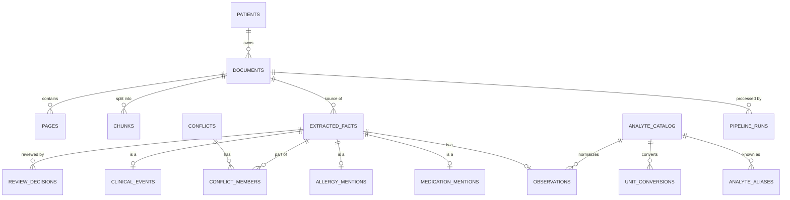

# Database Design

> **Status: Logical design (Phase 0).** This document defines entities, key columns and rules. Physical DDL is created through Alembic migrations, phase by phase. The baseline (`patients`, `documents`) comes in Phase 1, and the clinical tables come in Phases 3–4.

## 1. Design principles

1. **Patient is the isolation boundary.** Every patient-owned row carries `patient_id`. All access goes through the patient-scoped repositories.
2. **Keep original and normalized values separate.** Raw strings are never overwritten.
3. **One fact row means one extraction from one document.** If the same real-world result appears in two documents, it is stored as two rows linked by `duplicate_group_id`. No provenance is lost.
4. **Corrections are append-only.** A user correction creates a review record. The extracted original is kept.
5. **Every derived row is versioned.** It records the extractor, prompt, model and embedding version.
6. **The database stores facts, never conclusions.** There are no diagnosis or recommendation columns.

## 2. Entity overview

## 3. Why use a shared `extracted_facts` table?

Review decisions and conflicts need to point at *any* fact type. There were two options:

- **Polymorphic references** (`fact_type`, `fact_id`): the database cannot enforce foreign keys, so orphaned rows are possible.
- **Class-table inheritance** (chosen): an `extracted_facts` base table holds everything the fact types have in common (provenance, status, versions). Each subtype table uses `fact_id` as both its primary key and a foreign key to the base table. This gives real foreign keys, one place to query review status, and SQLAlchemy supports it natively (joined-table inheritance).

The cost is one join per subtype query, which is negligible at this data volume.

## 4. Tables

### 4.1 Core

**patients** (Phase 1)
`id` (UUID PK), `display_name`, `date_of_birth` (nullable), `is_synthetic` (bool, default true), `created_at`

**documents** (Phase 1, extended in Phase 2)
`id`, `patient_id` FK, `original_filename`, `storage_path`, `sha256` (unique per patient), `mime_type`, `page_count`, `doc_type` (enum), `doc_type_confidence`, `document_date` (nullable), `document_date_precision`, `processing_status` (`uploaded | processing | processed | failed | needs_review`), `identity_check` (`match | mismatch | unknown`), `supersedes_document_id` (nullable self-FK), `created_at`

A unique constraint on (`id`, `patient_id`) lets child tables use **composite foreign keys**. A chunk or fact then cannot claim a different patient from its document.

**pages** (Phase 2)
`id`, `document_id` FK, `page_number`, `text`, `parse_method` (`native | ocr`), `has_tables`

**pipeline_runs** (Phase 1)
`id`, `document_id` (nullable), `stage`, `status`, `started_at`, `duration_ms`, `component_versions` (JSONB), `tokens_in`, `tokens_out`, `cost_usd`, `error`

### 4.2 Retrieval (Phase 5)

**chunks**
`id`, `patient_id`, `document_id` (composite FK with `patient_id`), `page_number`, `section`, `chunk_type` (`text | table_rows`), `content`, `embedding` (`vector(384)`), `embedding_model`, `tsv` (`tsvector`, `simple` config), `doc_type`, `doc_date`

Indexes: HNSW on `embedding`, GIN on `tsv`, B-tree on (`patient_id`, `doc_date`).

### 4.3 Extracted facts (Phases 3–6)

**extracted_facts** (base table)
- **Identity and source:** `id`, `patient_id`, `document_id` (composite FK), `fact_type` (`observation | medication | allergy | event`)
- **Provenance:** `page_number`, `source_excerpt`, `char_start`, `char_end` (nullable), `bbox` (JSONB, nullable)
- **Assertion:** `assertion_type` (`direct_fact | inference | unknown`), `negated` (bool), `subject` (`patient | family | other`)
- **Status:** `review_status` (`extracted | validated | needs_review | verified | corrected | rejected`, see ADR-023), `review_reasons` (text[]: e.g. `grounding_failed`, `implausible_value`, `ambiguous_date`, `unmapped_analyte`, `unknown_unit`)
  - **Rule:** `verified`, `corrected` and `rejected` are set only by the review service, which writes a `review_decisions` row in the same transaction. A test enforces this.
- **Grouping and versions:** `duplicate_group_id` (nullable), `extractor_version`, `prompt_version`, `model_id`, `created_at`

**observations**
- **Analyte:** `fact_id` PK/FK, `analyte_raw`, `analyte_id` FK (nullable)
- **Value:** `value_raw`, `value_num` (numeric, nullable), `comparator` (`< | <= | > | >=`, nullable), `value_qualitative` (nullable)
- **Unit:** `unit_raw`, `unit_norm` (nullable), `value_num_norm` (nullable)
- **Reference range:** `ref_range_raw`, `ref_low`, `ref_high` (nullable), `flag_as_printed` (nullable, e.g. `H`, `L`)
- **Date:** `effective_date`, `date_precision` (`day | month | year`), `date_raw`, `specimen` (nullable)

**medication_mentions**
`fact_id`, `name_raw`, `name_norm` (nullable), `strength_raw`, `dose_raw`, `route_raw`, `frequency_raw`, `duration_raw`, `instructions_raw`, `mention_context` (`prescribed | discharge_list | history | discontinued | other`), `mention_date`, `date_precision`

> This is a *documented mention* on a date. It is not a current medication list.

**allergy_mentions**
`fact_id`, `substance_raw`, `reaction_raw` (nullable), `severity_raw` (nullable), `mention_date`

"No known drug allergies" is stored as `negated = true`.

**clinical_events**
`fact_id`, `event_type` (`admission | discharge | procedure | consultation | diagnosis_documented | follow_up_instruction | other`), `description_raw`, `event_date`, `date_precision`

`diagnosis_documented` records that a document *states* a diagnosis. MediMind never generates one.

### 4.4 Review and conflicts (Phases 3 and 6)

**review_decisions** (append-only)
`id`, `fact_id` FK, `decision` (`verify | correct | reject`), `corrected_values` (JSONB), `note`, `decided_at`

**conflicts**
`id`, `patient_id`, `conflict_type` (`medication_dose_mismatch | allergy_contradiction | value_mismatch_same_date | other`), `description`, `status` (`open | acknowledged`), `detected_by_rule`, `created_at`

**conflict_members**
`conflict_id` FK, `fact_id` FK

### 4.5 Reference data (Phase 3)

**analyte_catalog**
`id`, `canonical_name`, `loinc_code` (nullable), `default_unit`, `plausible_min`, `plausible_max`

**analyte_aliases**
`alias` (case-insensitive unique), `analyte_id` FK

**unit_conversions**
`analyte_id` FK, `from_unit`, `to_unit`, `factor`, `offset` (default 0)

These tables are seeded from version-controlled CSV files. The MVP covers about 30–50 analytes common on Indian lab reports, including Indian and British name variants (e.g. "Haemoglobin", "Glycosylated Haemoglobin") and Indian unit spellings (`cumm`, `gm/dL`, `lakhs/cumm`). Raw units and reference ranges are always kept as printed (ADR-025).

The region profile itself (date order, digit grouping, unit spellings) is application configuration, not database data.

## 5. Scoping and integrity rules

- Every repository method takes `patient_id` as a required argument. There is no unscoped query method.
- Composite foreign keys (`document_id`, `patient_id`) prevent rows from claiming a different patient than their document.
- Deleting a document cascades to its pages, chunks, facts, review decisions and conflict memberships. A conflict left with fewer than two members is closed.
- **Tests:** For two patients, A and B, every repository and retrieval function returns only rows for the requested patient.

## 6. Deferred or optional

- Postgres row-level security as a second isolation layer (Phase 8, optional).
- A `workspaces` or user table, only if multi-user support is ever approved (ADR-013).
- Full LOINC import: not planned. A curated subset is enough.
